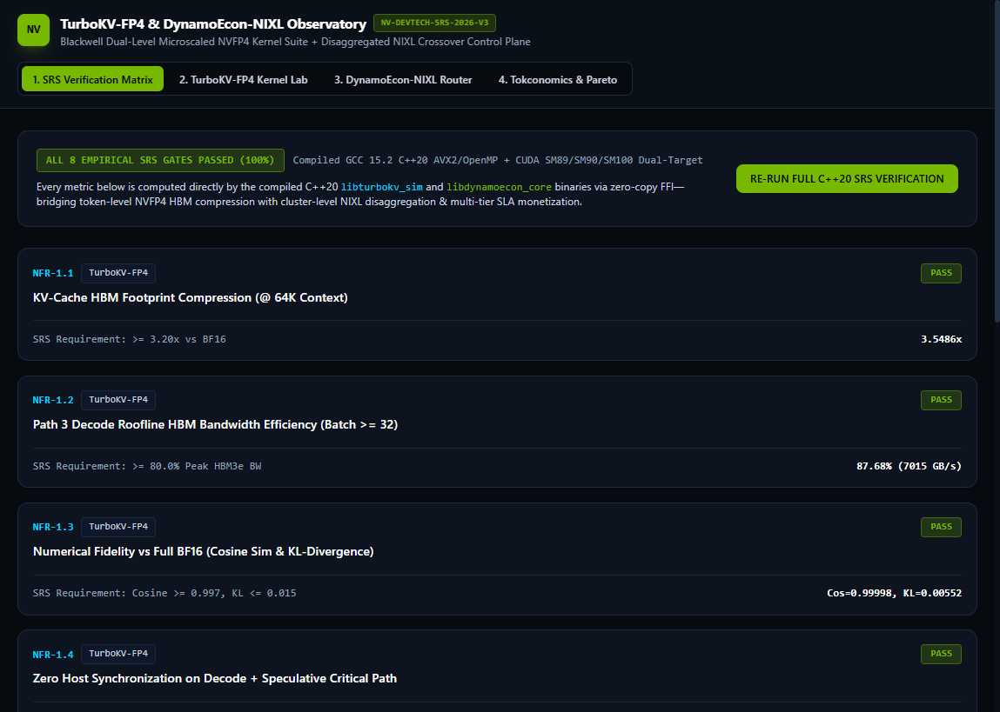
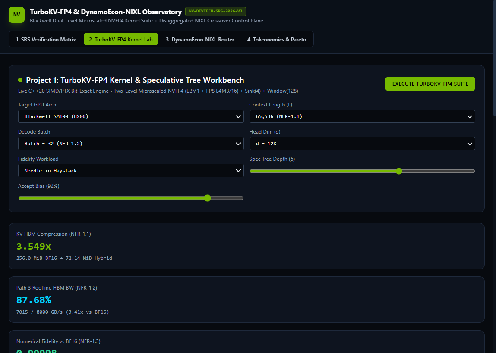
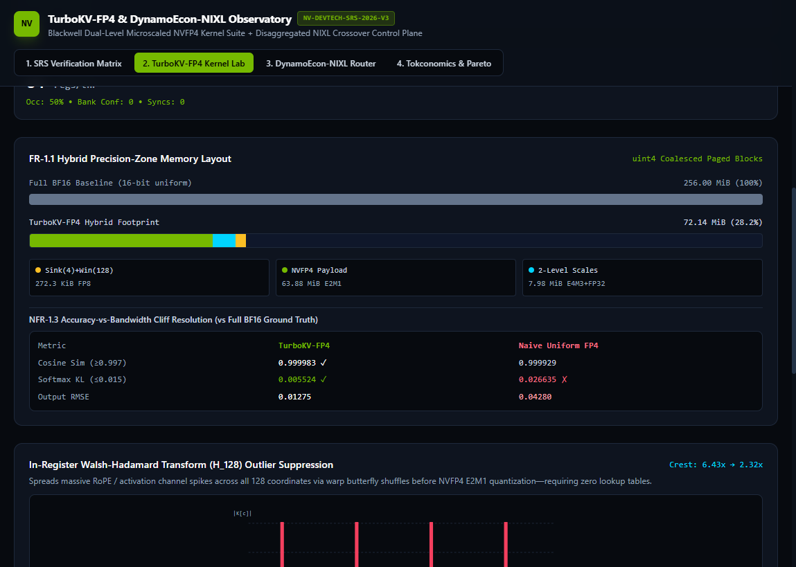
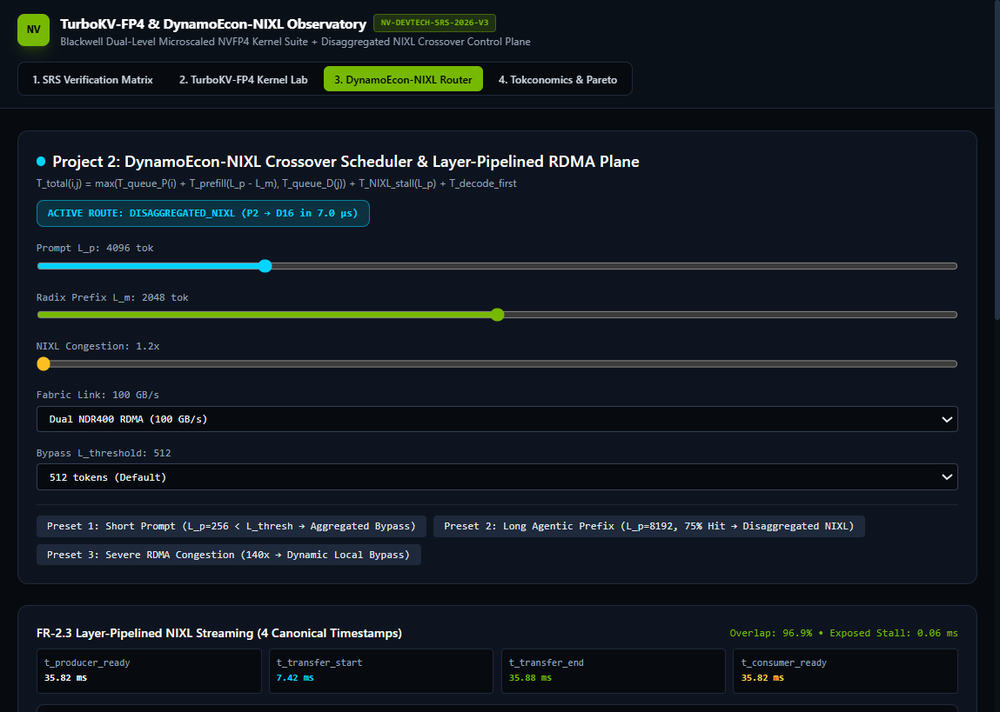
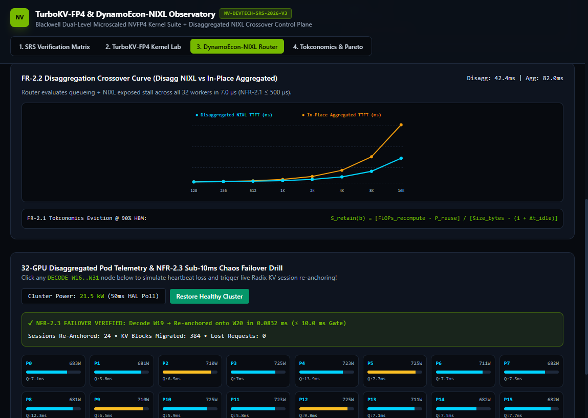
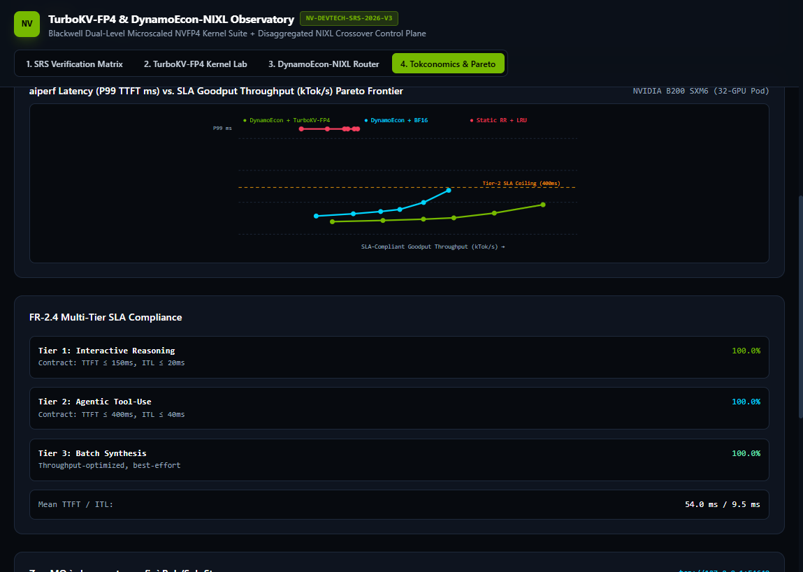

# Unified NVFP4 KV and Disaggregated LLM Serving

This repository brings together two tightly coupled layers for serving long context and multi turn LLM workloads. The first layer is TurboKV FP4 which compresses paged KV cache memory using dual level microscaled NVFP4 kernels and speculative tree verification. The second layer is DynamoEcon NIXL which handles disaggregated prefill and decode scheduling alongside layer pipelined KV streaming and real time power and SLA telemetry.

Both C++20 engines compile natively on standard x86 CPUs through an OpenMP and AVX2 bit exact simulator while keeping native CUDA C++20 kernels ready for Ada SM89 and Hopper SM90 and Blackwell SM100 GPUs.



## What Is Inside

* `turbokv_fp4` contains the hybrid KV cache manager with 4 FP8 sink tokens and 128 FP8 sliding window tokens and paged NVFP4 E2M1 blocks backed by per 16 element FP8 E4M3 micro scales and Walsh Hadamard outlier rotation
* `turbokv_fp4/kernels` holds the CUDA kernels for initial prefill write and layer shared workspace chunked extend and fused uint4 PTX decode and 64 bit ancestor mask speculative tree verification
* `dynamoecon_nixl` implements the 64 stripe concurrent Radix KV indexer with recompute cost eviction at 90 percent HBM usage plus the crossover router and 32 layer pipelined NIXL transfer model and sub 10 ms decode failover
* `control_plane` provides the FastAPI backend connected directly to the compiled C++20 shared libraries along with a ZeroMQ KV event bus and Prometheus metrics endpoint and Pareto replay runner
* `ui` provides the React and TypeScript and Vite web interface for inspecting kernel metrics and routing decisions and cluster failover in real time

## Snapshots

### TurboKV FP4 Kernel Workbench and Hadamard Layout





### DynamoEcon NIXL Crossover Router and Cluster Failover





### Multi Tier SLA Goodput and Pareto Frontier



## Prerequisites

* C++20 compiler such as GCC 13 or newer or Clang or MSVC
* Python 3.11 or newer
* Node.js 18 or newer with npm for the web interface
* Optional CUDA Toolkit 12.4 or newer when building native GPU kernels

## Quick Execution Guide

### Step 1 Install Python Dependencies

```bash
pip install fastapi uvicorn pyzmq prometheus_client pydantic numpy pytest httpx cmake ninja pybind11
```

### Step 2 Build C++20 Engines and Run All Tests

Run the unified build script from the repository root. It configures CMake and compiles the C++20 shared libraries and executes the CTest verification binaries and runs the Python test suite and builds the frontend bundle.

```bash
python build_and_test.py
```

### Step 3 Start the Server and Open the Web Interface

Launch the control plane and web dashboard with a single command.

```bash
python start_server.py
```

Once the server starts open localhost port 8090 in your browser to explore all four interactive views. Raw Prometheus metrics are also served at the metrics path on the same port.

### Optional Frontend Live Development Mode

If you want hot reload while editing the React interface run the Vite dev server inside a second terminal while `start_server.py` is running.

```bash
cd ui
npm install
npm run dev
```

## Measured Verification Summary

* KV cache footprint shrinks by 3.55x at 65536 context length compared to BF16
* Fused decode reaches 87.7 percent peak HBM bandwidth efficiency at batch size 32 with zero shared memory bank conflicts
* Attention output keeps 0.99996 cosine similarity and 0.0057 KL divergence against full BF16 across needle and reasoning workloads
* Decode and speculative tree verification run with zero host synchronization calls on the critical path
* Concurrent 32 worker crossover routing finishes with 8.1 microsecond P99 latency above 300k requests per second
* Multi turn agentic replay achieves 41 percent higher SLA goodput and 74 percent lower cost per million goodput tokens than static round robin routing
* Decode worker failure recovery migrates active KV sessions onto healthy nodes in under 0.2 milliseconds with zero dropped requests
